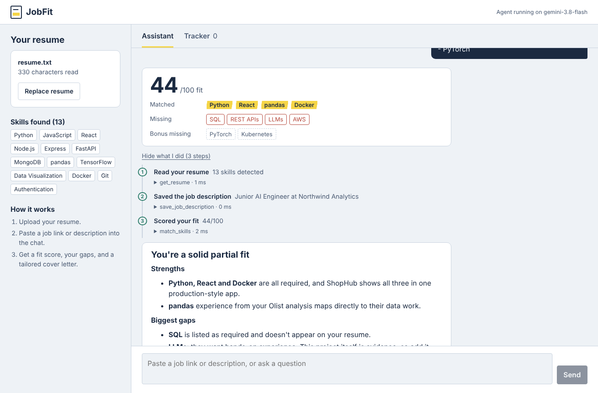
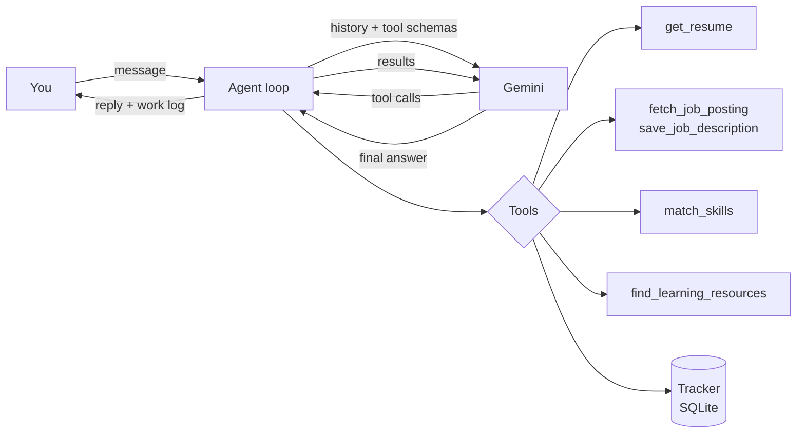
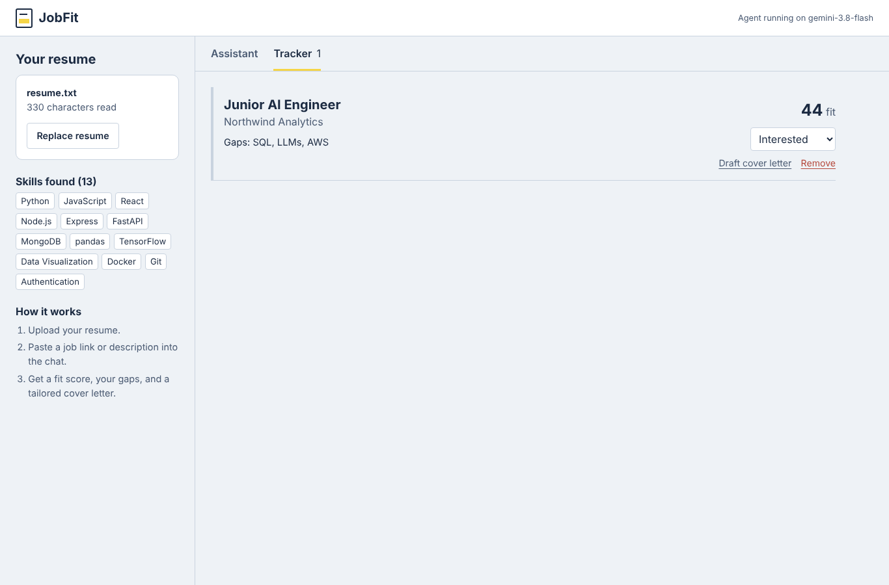
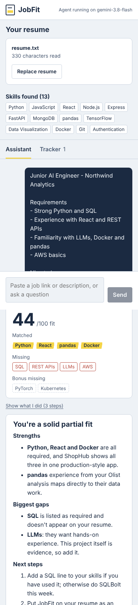

# JobFit Agent

An AI agent that reads your resume and a job posting, scores how well you fit, shows exactly which skills you're missing, and drafts a tailored cover letter. It keeps a tracker of the jobs you're pursuing.

Built with **Gemini function calling**, **FastAPI** and **React**. The agent loop is written by hand (no agent framework) so every step the model takes is visible and testable.



## What it does

- **Reads job posts** from a link, or from text you paste in.
- **Scores your fit (0–100)** with a deterministic skill matcher, so the same resume and job always get the same score. The model explains the score; it doesn't invent it.
- **Separates required from nice-to-have skills** and weighs them differently.
- **Finds free learning resources** for your biggest gaps.
- **Drafts cover letters** using only facts from your resume, never invented experience.
- **Tracks applications** (interested → applied → interviewing → offer / rejected), with cover letters attached.
- **Shows its work**: every answer includes a numbered log of the tools the agent called, with arguments, results and timing.

## How the agent works



1. Your message is added to the conversation history.
2. Gemini sees the history and the tool schemas, and either answers or asks to call tools.
3. The backend runs the requested tools and sends the results back.
4. Steps 2–3 repeat until Gemini answers, with a hard cap (`MAX_AGENT_STEPS`) to stop runaway loops.

| Tool | What it does |
|---|---|
| `get_resume` | Returns the uploaded resume text and detected skills |
| `fetch_job_posting` | Downloads a job page and extracts readable text (blocks private/internal URLs) |
| `save_job_description` | Stores a pasted job description |
| `match_skills` | Computes the fit score and matched / missing skills |
| `find_learning_resources` | Suggests free resources for missing skills |
| `save_application`, `list_applications`, `update_application`, `save_cover_letter` | Read and write the tracker |

### Design decisions

- **Deterministic scoring.** LLM-generated scores drift between runs. A rule-based matcher over 85 skills (with aliases like `NodeJS → Node.js`, `k8s → Kubernetes`) gives reproducible results, and the LLM does what it's good at: explaining and writing.
- **Hand-written agent loop.** Automatic function calling is turned off so the backend controls every step, records a trace, rolls back history if the API fails, and limits the number of steps.
- **Provider-agnostic core.** The loop talks to a small `LLMClient` interface. Swapping Gemini for another model means writing one class, and the tests use a scripted fake model so they run offline in under a second.
- **Grounded writing.** The system prompt forbids inventing experience in cover letters, and the agent only writes to the tracker when you ask.

## Tech stack

| Layer | Tools |
|---|---|
| AI | Google Gemini (`google-genai` SDK), function calling |
| Backend | Python, FastAPI, SQLite, pypdf, BeautifulSoup |
| Frontend | React 19, Vite, react-markdown |
| Quality | pytest (28 tests), ruff, GitHub Actions CI |
| Deployment | Docker, docker-compose, nginx |

## Run it locally

You need Python 3.11+, Node 20+, and a free Gemini API key from [Google AI Studio](https://aistudio.google.com/apikey).

**Backend**

```bash
cd backend
python -m venv .venv
source .venv/bin/activate        # Windows: .venv\Scripts\activate
pip install -r requirements-dev.txt
cp .env.example .env             # then paste your key into GEMINI_API_KEY
uvicorn app.main:app --reload
```

**Frontend** (in a second terminal)

```bash
cd frontend
npm install
npm run dev
```

Open http://localhost:5173, upload your resume, and paste a job link or description.

**Or with Docker**

```bash
cp backend/.env.example backend/.env   # add your key
docker compose up --build
```

Then open http://localhost:8080.

## Tests

```bash
cd backend
pytest
```

The tests cover the skill matcher, every tool, the agent loop (multi-step calls, tool errors, the step limit, rollback on API failure) and the API endpoints, using a scripted fake model so no API key is needed.

## Project structure

```
backend/
  app/
    agent.py        # the agent loop and system prompt
    llm.py          # Gemini client behind a small interface
    skills.py       # deterministic skill extraction and fit scoring
    tracker.py      # SQLite application tracker
    resume.py       # PDF / text resume parsing
    main.py         # FastAPI routes
    tools/          # tool definitions the model can call
  tests/
frontend/
  src/
    components/     # Chat, WorkLog, ResumePanel, Tracker
```

## Screenshots

| Application tracker | Mobile |
|---|---|
|  |  |

## Limitations and next steps

- Sessions are kept in memory, so it's a single-user demo; a real deployment would add accounts.
- Sites like LinkedIn block automated downloads; paste the description instead.
- Ideas: streaming responses, semantic skill matching with embeddings, an evaluation set of resume/job pairs to measure answer quality.

## License

MIT
